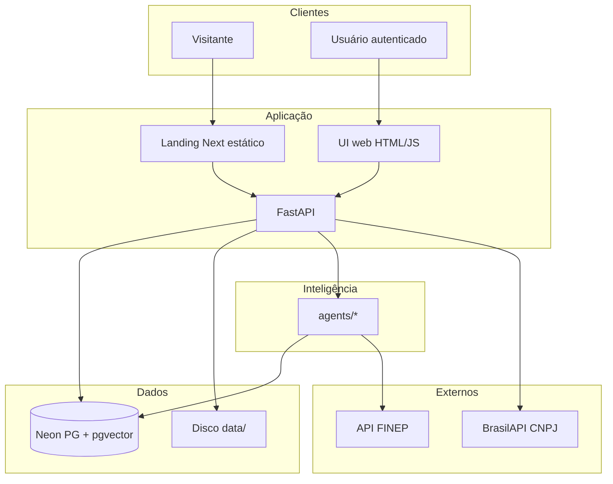
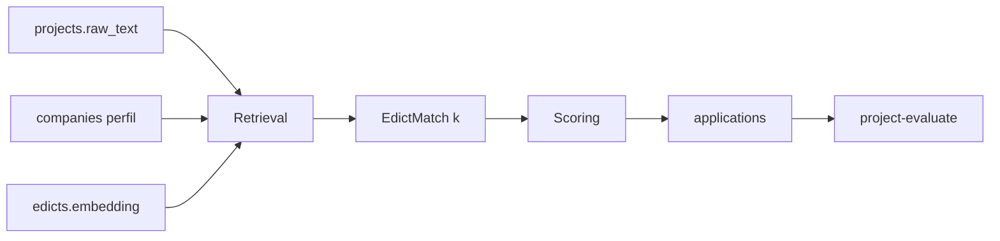
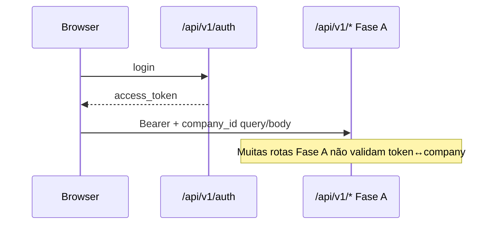

# Arquitetura SADS (estado atual)

Documento técnico complementar a `docs/MANUAL_COMPLETO_SADS.md`.

---

## 1. Contexto

```mermaid
C4Context
  title SADS — contexto (simplificado)
```



---

## 2. Componentes e responsabilidades

| Componente | Path | Responsabilidade |
|------------|------|------------------|
| Gateway HTTP | `app/main.py` | Health, static, landing, `submit-project` |
| Auth | `app/auth.py`, `routes_auth.py` | Register/login/token/reset |
| Fase A API | `app/routes_fase_a.py` | Companies, projects, evaluate, docs, apps, dashboard |
| Schemas | `app/schemas.py` | Contratos Pydantic |
| Embeddings | `app/embeddings.py` | Vetores query/corpus |
| LLM | `app/llm.py` | Template se `LLM_PROVIDER=none` |
| ORM | `db/models.py` | Entidades |
| Sessão DB | `db/session.py` | Async SQLAlchemy |
| Agentes | `agents/*.py` | Pipeline inteligente |
| UI | `web/*` | Fase A |
| Landing | `landing/` | Marketing |

---

## 3. Fluxo de dados — recomendação



**Isolamento:** texto do projeto **não** é gravado em `edicts`.

---

## 4. Faixas agenticas

### Faixa A — corpus (offline)
`ScraperAgent` → extract/seed → `IndexerAgent` → `edicts.embedding`

### Faixa B — online
UI/API → `RetrievalAgent` → `ScoringAgent` → persistência  
(`Orchestrator` + `GenerationAgent` no E2E CLI/API submit-project)

---

## 5. Decisão de scoring (implementada)

Arquivo: `agents/scoring_agent.py`  
Pesos: similarity 0.3, area 0.25, trl 0.15, size 0.15, region 0.1, budget 0.05  
Gates: prazo / porte / TRL / região  
Ordenação: `(eligible, score)` desc  

**Não implementado:** AHP, TOPSIS, aprendizado dos pesos.

---

## 6. Autenticação × autorização



**Risco arquitetural conhecido:** reforçar `Depends(get_current_user)` + checagem de tenant.

---

## 7. Deploy mental (dev)

1 processo Uvicorn → serve API + `web/` + `landing/out` + `/_next`.  
Estado: arquivos locais em `data/` + Neon remoto.

---

## 8. Arquitetura pretendida (proposta / TCC)

- SSO OAuth  
- RBAC por papel  
- Chat LLM controlado  
- Catálogo multi-fonte  
- Possível convergência front (Next) e auth corporativa  
- Métodos multicritério formais (AHP/TOPSIS) a validar  

Não confundir com o PoC em execução.
