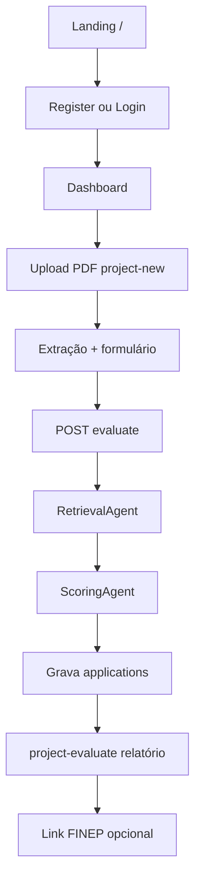
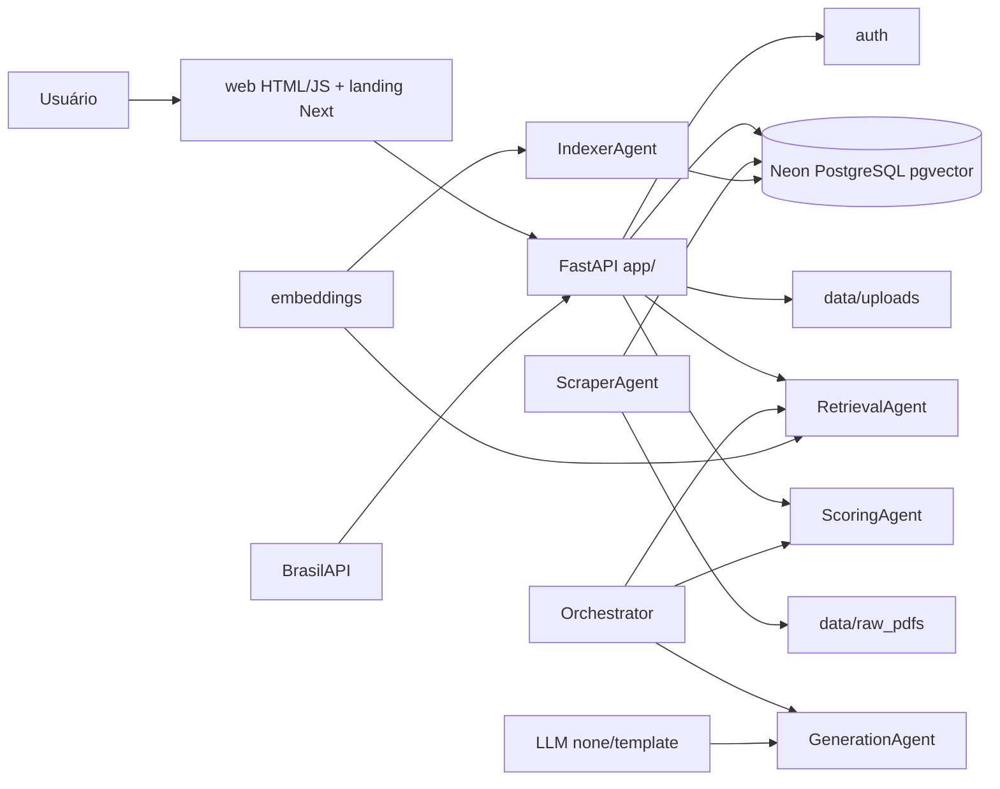
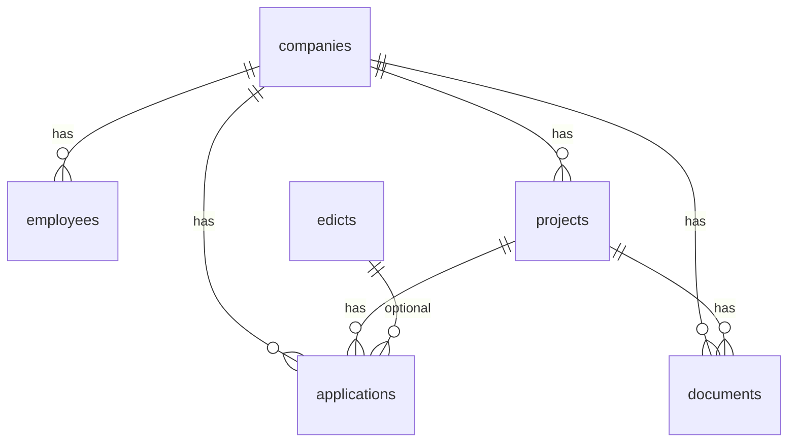
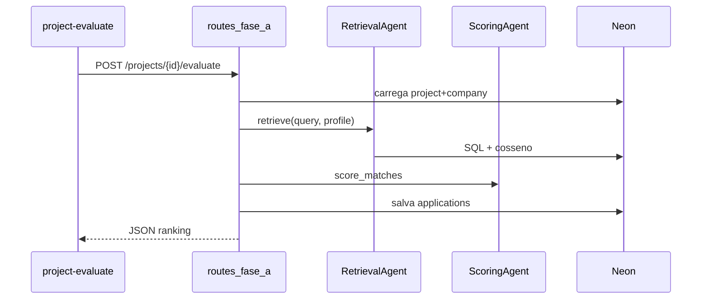

# Manual completo — SADS

**SADS** — Sistema de Apoio à Decisão para Fomento à Inovação

| Campo | Valor |
|-------|--------|
| Objetivo do documento | Nivelar o grupo, preparar TC1/TCC e registrar o estado **real** do repositório |
| Versão do documento | 1.0 |
| Data de geração | 2026-09-30 |
| Commit Git mais recente (histórico) | `634f49a` — *chore: inicializa estrutura* (2026-08-28) |
| Escopo analisado | Working tree atual do repositório (código além do commit inicial) |
| Curso / disciplina | Ciência da Computação — UNIP Paraíso · TC1 / TCC (conforme docs do grupo) |
| Integrantes (docs TCC) | Letícia Melo · Filipe Ribeiro · Fabiano Rocha · Ruben Pereira · Victor Yukio |

> **Classificações usadas:** IMPLEMENTADO · PARCIALMENTE IMPLEMENTADO · PROTÓTIPO · MOCKADO · PLANEJADO · NÃO IDENTIFICADO

---

## Sumário

1. [Capa e identificação](#1-capa-e-identificação)  
2. [Guia de leitura rápida](#2-guia-de-leitura-rápida)  
3. [Contexto do problema](#3-contexto-do-problema)  
4. [Problema de pesquisa](#4-problema-de-pesquisa)  
5. [Objetivos](#5-objetivos)  
6. [Escopo](#6-escopo-do-sistema)  
7. [Personas e perfis](#7-personas-e-perfis-de-acesso)  
8. [Jornada do usuário](#8-jornada-completa-do-usuário)  
9. [Funcionalidades](#9-funcionalidades-detalhadas)  
10. [Arquitetura](#10-arquitetura-do-sads)  
11. [Componentes inteligentes](#11-componentes-inteligentes-e-agentes)  
12. [Regras + multicritério + LLM](#12-por-que-combinar-regras-métodos-multicritério-e-modelos-de-linguagem)  
13. [Explicabilidade](#13-explicabilidade)  
14. [Segurança e LGPD](#14-segurança-privacidade-e-lgpd)  
15. [Integrações](#15-integrações-e-ferramentas)  
16. [Estrutura do repositório](#16-estrutura-do-repositório)  
17. [Fluxos técnicos](#17-fluxos-técnicos-principais)  
18. [Testes](#18-testes-e-validação)  
19. [Como executar](#19-como-executar-o-sistema)  
20. [Dados de demonstração](#20-dados-de-demonstração)  
21. [Limitações e riscos](#21-limitações-e-riscos)  
22. [Evolução planejada](#22-evolução-planejada)  
23. [Contribuição acadêmica](#23-contribuição-acadêmica)  
24. [Guia da apresentação](#24-guia-da-apresentação-para-o-professor)  
25. [Sugestões de fala](#25-sugestões-de-fala-obrigatórias)  
26. [Perguntas do professor](#26-perguntas-que-o-professor-pode-fazer)  
27. [Divisão entre integrantes](#27-divisão-de-conhecimento-entre-integrantes)  
28. [Glossário](#28-glossário)  
29. [Checklist final](#29-checklist-final-do-grupo)  
30. [Divergências proposta × código](#30-divergências-entre-a-proposta-e-a-implementação-atual)  
31. [Processo de desenvolvimento](#31-processo-de-desenvolvimento)

---

## 1. Capa e identificação

Ver tabela no topo. Este manual descreve o **estado atual** do código e da documentação em `docs/`, sem inventar tecnologias.

---

## 2. Guia de leitura rápida

### O que é o SADS?
Aplicação web de **apoio à decisão** que cruza o perfil de uma organização e o texto de um projeto (PDF) com um **corpus de editais** (piloto **FINEP**), produzindo **ranking de aderência**, justificativas, lacunas e registro de aplicações.

### Qual problema resolve?
Reduzir o esforço manual de localizar, interpretar e comparar oportunidades de fomento compatíveis com o projeto.

### Quem utiliza?
Organizações (multi-tenant por `company_id`) e seus funcionários autenticados (papel padrão `admin` no cadastro). Visitantes veem a landing pública.

### Principal entrega
Relatório de recomendação (`web/project-evaluate.html`) com score, breakdown, forças/fraquezas e link para a chamada (quando houver URL).

### Fluxo (resumo)
Cadastro/login → upload PDF → extração/formulário → `POST .../evaluate` → Retrieval + Scoring → grava `applications` → UI do relatório.

### Implementado hoje (síntese)
Auth senha, CRUD Fase A, coleta/indexação FINEP, retrieval híbrido, scoring matriz v2, pipeline/orquestrador com generation por **template**, landing Next.js, UI HTML.

### Planejado
Chat LLM, SSO/OAuth, RBAC fino, scraper multi-portal em produção, AHP/TOPSIS formais, hardening de auth em todas as rotas de projeto.

### Contribuição técnica
Pipeline de **agentes/componentes especializados** (coletor, indexador, retrieval, scoring, generation, orquestrador) + score **explicável** + corpus vetorial (pgvector), sob supervisão humana.

### Se você tiver apenas cinco minutos — sete pontos

1. SADS recomenda fomento; **não garante aprovação**.  
2. Núcleo agentico: Retrieval + Scoring sobre corpus FINEP.  
3. LLM externo: **desligado** (`LLM_PROVIDER=none`).  
4. Projeto fica por empresa; **não** entra no corpus público.  
5. UI autenticada em `web/`; landing em `landing/`.  
6. API: FastAPI em `app/`; agentes em `agents/`.  
7. AHP/TOPSIS e SSO: **PLANEJADOS**, não implementados no scoring atual.

---

## 3. Contexto do problema

**Fomento à inovação** é o conjunto de mecanismos (financeiros e não financeiros) que apoiam Pesquisa, Desenvolvimento e Inovação (PD&I).

Empresas buscam fomento para reduzir risco, acelerar PD&I e acessar redes/ICTs. As oportunidades estão **dispersas** (FINEP, FAPs, BNDES, EMBRAPII, incentivos fiscais etc.), com **critérios distintos** e documentos extensos.

### Termos

| Termo | Significado |
|-------|-------------|
| Mecanismo de fomento | Categoria ampla (edital, crédito, fiscal, parceria) |
| Programa | Linha contínua de apoio de uma instituição |
| Chamada / edital | Instrumento concreto com prazo e regras |
| Instituição financiadora | Órgão que publica/opera o apoio (ex.: FINEP) |
| Incentivo fiscal | Benefício tributário (ex.: Lei do Bem) — **não** é o foco do PoC atual |
| Crédito | Financiamento (ex.: linhas BNDES) — **PLANEJADO** no catálogo multi-fonte |
| Não reembolsável | Subvenção / recurso a fundo perdido, quando aplicável ao instrumento |

---

## 4. Problema de pesquisa

> Como apoiar, de maneira estruturada e explicável, a identificação de mecanismos de fomento compatíveis com o perfil de uma organização e de seu projeto de inovação?

O desafio inclui interpretar critérios, restrições eliminatórias, comparação, justificativa, lacunas e rastreabilidade — não apenas “buscar texto”.

---

## 5. Objetivos

### 5.1 Objetivo geral
Desenvolver um sistema de apoio à decisão que estruture empresa/projeto/programas, avalie compatibilidade e apresente recomendações justificáveis.

### 5.2 Objetivos específicos

| Objetivo | Status | Evidência | Pendência |
|----------|--------|-----------|-----------|
| Cadastrar organizações e usuários | IMPLEMENTADO | `app/routes_auth.py`, `register.html` | SSO |
| Receber informações do projeto | IMPLEMENTADO | `POST /projects`, `project-new.html` | — |
| Processar documentos PDF | PARCIALMENTE IMPLEMENTADO | `scripts/extract_pdfs.py`, `app/pdf_form.py` | OCR de PDF escaneado |
| Estruturar critérios / catálogo | PARCIALMENTE IMPLEMENTADO | `edicts` + seed FINEP | Multi-fonte, metadados incompletos |
| Verificar elegibilidade | PARCIALMENTE IMPLEMENTADO | gates no `scoring_agent.py` | Cobertura de regras oficiais |
| Calcular aderência / ranking | IMPLEMENTADO | matriz v2 em `scoring_agent.py` | AHP/TOPSIS |
| Justificar resultados / lacunas | IMPLEMENTADO | strengths/weaknesses + UI relatório | — |
| Histórico de aplicações | IMPLEMENTADO | tabela `applications`, `applications.html` | — |
| Controles de acesso e privacidade | PARCIALMENTE IMPLEMENTADO | auth token; `company_id` | Auth em todas rotas Fase A; RBAC fino |

---

## 6. Escopo do sistema

### Dentro do escopo (PoC / Fase A)
- Landing, registro/login, painel, projeto PDF, materiais, aplicações, equipe  
- Corpus FINEP (coleta + embeddings)  
- Evaluate → ranking top-N  
- Pipeline CLI/API `submit-project`  

### Fora do escopo
- Garantir aprovação  
- Submissão oficial automática ao órgão  
- Substituir consultoria/parecer jurídico  
- Catálogo nacional em tempo real completo  
- Decisão final sem humano  

### Premissas e dependências
- Neon PostgreSQL + extensão `vector`  
- Chamadas FINEP acessíveis via API pública usada pelo coletor  
- Python 3.10–3.12 recomendado; embeddings podem usar fallback `hashing`  

---

## 7. Personas e perfis de acesso

| Perfil | Status | Objetivo | Permissões no PoC |
|--------|--------|----------|-------------------|
| Visitante | IMPLEMENTADO | Ver landing | Sem token |
| Funcionário autenticado | IMPLEMENTADO | Operar a org | UI usa `company_id` da sessão; role padrão `admin` no register |
| Admin da org | PARCIALMENTE IMPLEMENTADO | Campo `employees.role` | Pouca diferenciação de UI por papel |
| Gestor / curador de catálogo | PLANEJADO | Manter fontes | Não há painel de curadoria dedicado |
| SSO corporativo | PLANEJADO | Fase B | README / product_ui |

Rotas em `routes_fase_a.py` em geral **não** usam `Depends(get_current_user)` — isolamento depende do cliente enviar o `company_id` correto (**limitação de segurança**).

---

## 8. Jornada completa do usuário



| Passo | Tela / rota | Status | Erros típicos |
|-------|-------------|--------|---------------|
| 1 Landing | `/` (`landing/out`) | IMPLEMENTADO | Build Next ausente → fallback |
| 2 Register | `/register.html` + `/api/v1/auth/register` | IMPLEMENTADO | Validação senha/empresa |
| 3 Login | `/login.html` | IMPLEMENTADO | Credenciais inválidas |
| 4 Dashboard | `/dashboard.html` | IMPLEMENTADO | Sem token → redirect |
| 5 Upload | `POST /api/v1/projects` | IMPLEMENTADO | Não-PDF |
| 6 Extração | `extract_pdf` + `guess_form_fields` | PARCIAL | PDF escaneado / pouco texto |
| 7 Evaluate | `POST /projects/{id}/evaluate` | IMPLEMENTADO | Corpus vazio / falha embedding |
| 8 Relatório | `project-evaluate.html` | IMPLEMENTADO | Sem applications |
| 9 Outcome | `applications.html` PATCH | IMPLEMENTADO | — |
| Chat | — | PLANEJADO Fase B | — |

---

## 9. Funcionalidades detalhadas

### 9.1 Landing page
- **Por quê:** comunicação pública.  
- **Técnico:** Next.js 15 + Tailwind → `landing/out`; servida por FastAPI.  
- **Status:** IMPLEMENTADO.

### 9.2 Autenticação
- **Arquivos:** `app/auth.py`, `routes_auth.py`, `login/register/forgot/reset`.  
- **Entradas:** empresa, e-mail, senha.  
- **Processamento:** PBKDF2 hash; token HMAC; reset opcional via SMTP ou URL em dev.  
- **Status:** IMPLEMENTADO (senha). SSO: PLANEJADO.

### 9.3 Cadastro de empresa
- No register cria `Company` + primeiro `Employee` admin.  
- `POST /companies` também existe. CNPJ via BrasilAPI (`cnpj_lookup.py`).  
- **Status:** IMPLEMENTADO.

### 9.4 Equipe
- `employee.html` + CRUD employees por `company_id`.  
- **Status:** IMPLEMENTADO (RBAC fino PLANEJADO).

### 9.5 Projeto + upload PDF
- `project-new.html` → multipart → salva em `data/uploads/<company_id>/`, `raw_text`, `form_data`.  
- **Status:** IMPLEMENTADO.

### 9.6 Materiais
- Documentos genéricos; tipo `project_pdf` pode criar projeto e ir ao evaluate.  
- **Status:** IMPLEMENTADO.

### 9.7 Catálogo / corpus FINEP
- Coletor `agents/scraper_agent.py` + `sources/finep.py`; seed `scripts/seed_corpus.py`; refresh `scripts/refresh_finep_corpus.py`.  
- **Status:** IMPLEMENTADO (piloto). Multi-fonte: PLANEJADO.

### 9.8 Motor de recomendação (evaluate)
- **Arquivos:** `retrieval_agent.py`, `scoring_agent.py`, `routes_fase_a.py` (`evaluate_project`).  
- **Entradas:** texto do projeto + perfil empresa.  
- **Saídas:** `applications` ranqueadas + payload JSON.  
- **Status:** IMPLEMENTADO. AHP/TOPSIS: PLANEJADO.

### 9.9 Relatório explicável
- UI monta score, barras do breakdown, lacunas, plano, URL FINEP (`url` / fallback `finep-{id}`).  
- Generation Markdown completo: pipeline/orquestrador (CLI/API submit-project).  
- **Status:** IMPLEMENTADO (UI) / PARCIAL (generation na UI vs CLI).

### 9.10 Aplicações / outcomes
- Status recommended/submitted/approved/rejected; métricas no dashboard (incl. top3_hit_rate quando houver outcomes).  
- **Status:** IMPLEMENTADO.

### 9.11 Chat
- **Status:** PLANEJADO (Fase B, `docs/product_ui.md`).

---

## 10. Arquitetura do SADS

### 10.1 Visão geral



### 10.2 Camadas reais
- **Apresentação:** `web/`, `landing/`  
- **Aplicação:** `app/routes_*.py`, `schemas.py`  
- **Inteligência:** `agents/`  
- **Persistência:** `db/models.py`, `db/session.py`, SQL em `db/init/`  
- **Jobs:** `scripts/`  

### 10.3 Frontend
- Área logada: HTML/CSS/JS estático (`web/app.js` sessão `localStorage`, tema claro/escuro).  
- Landing: React/Next export estático.  
- **Não** há Next como SPA autenticada completa (divergência vs SADS.pdf React/Auth.js).

### 10.4 Backend
- FastAPI, Pydantic, SQLAlchemy async, httpx.  
- Auth nas rotas `/api/v1/auth/*`.  

### 10.5 Banco (entidades)



Principais tabelas: `companies`, `employees`, `projects`, `documents`, `applications`, `edicts` (+ coluna `embedding` via SQL/pgvector).

### 10.6 Fluxo do PDF
Upload → validação PDF → disco → `extract_pdf` → `guess_form_fields` → `projects.raw_text` / `form_data` → evaluate usa texto → não reindexa o projeto no corpus de editais.

### 10.7 Motor de recomendação
1. **Elegibilidade (soft gates):** prazo, porte, TRL, região (`scoring_agent.py`).  
2. **Aderência:** pesos fixos similaridade 0,30 · área 0,25 · TRL 0,15 · porte 0,15 · região 0,10 · orçamento 0,05.  
3. **Priorização:** elegíveis primeiro, depois score.  
4. **Justificativa:** strengths/weaknesses/summary.  
5. **AHP/TOPSIS:** **NÃO IMPLEMENTADOS** (PLANEJADOS na proposta).

---

## 11. Componentes inteligentes e agentes

Termo preferido: **componentes inteligentes especializados** (agentes de software por tarefa), sob regras e supervisão humana.

| Componente | Arquivo | Status | Entrada → saída |
|------------|---------|--------|-----------------|
| Coletor | `scraper_agent.py` | IMPLEMENTADO (piloto) | API FINEP → PDFs/metadados |
| Indexador | `indexer_agent.py` | IMPLEMENTADO | texto edital → embedding |
| Retrieval | `retrieval_agent.py` | IMPLEMENTADO | projeto+perfil → top-k matches |
| Scoring | `scoring_agent.py` | IMPLEMENTADO | matches → ScoreReport[] |
| Generation | `generation_agent.py` | IMPLEMENTADO | scoring → MD template |
| Orquestrador | `orchestrator.py` | IMPLEMENTADO | E2E retrieve→score→generate |

**Não é agente:** auth, CRUD, upload, UI, persistência de `applications`.

### Processo de construção (verificável)
Definição de tarefa (IDs T-005…T-042) → contratos dataclass → regras/pesos → scripts CLI → testes em `tests/` → integração FastAPI/UI → revisão e versionamento Git.

**Não há** evidência de treinamento/fine-tuning de modelo próprio. Embeddings usam modelo pronto (`sentence-transformers`) ou fallback hashing. LLM: provedor `none` + template (`app/llm.py`).

---

## 12. Por que combinar regras, métodos multicritério e modelos de linguagem

| Abordagem | Papel no PoC |
|-----------|--------------|
| Regras / gates | Prazo, porte, TRL, região |
| Multicritério (matriz v2) | Score ponderado — **não** AHP/TOPSIS ainda |
| LLM | **Não usado** no fluxo atual; template local; chat PLANEJADO |

O modelo de linguagem **não** deve decidir elegibilidade objetiva sozinho.

---

## 13. Explicabilidade

O relatório expõe: ranking, score %, barras (similarity/area/trl/size/region/budget), forças, fraquezas/lacunas, resumo, comparação com 2º lugar, pesos declarados, link FINEP.

Evita score “opaco” ao exigir breakdown persistido em `applications.breakdown`.

---

## 14. Segurança, privacidade e LGPD

| Controle | Finalidade | Status | Evidência | Pendência |
|----------|------------|--------|-----------|-----------|
| Senha PBKDF2 + token | Auth | IMPLEMENTADO | `app/auth.py` | SSO |
| `company_id` | Isolamento lógico | PARCIAL | models + UI | Authz server-side em todas rotas |
| LLM none | Evitar envio externo | IMPLEMENTADO | `.env.example`, `llm.py` | Política se ligar API |
| Projeto ≠ corpus | Separação de dados | IMPLEMENTADO | fluxo evaluate | — |
| SMTP opcional | Reset senha | PARCIAL | `mailer.py` | Produção |
| Segredos em `.env` | Não versionar | IMPLEMENTADO | `.gitignore` | Rotação |
| HTTPS | Trânsito | NÃO IDENTIFICADO no deploy local | Depende do host | Produção |
| Prompt injection em PDF | Risco | PARCIAL | texto vai ao retrieval | Sanitização/limites |
| LGPD formal | Direitos titular | PLANEJADO / parcial | Landing menciona | Política publicada, exclusão formal |

**Não afirmar:** “dados nunca vazam” / “LGPD 100%”.

---

## 15. Integrações e ferramentas

| Tecnologia | Finalidade | Onde |
|------------|------------|------|
| FastAPI / Uvicorn | API | `app/` |
| SQLAlchemy / asyncpg | ORM / DB | `db/` |
| Pydantic Settings | Config | `app/config.py` |
| Neon + pgvector | Persistência vetorial | `DATABASE_URL` |
| sentence-transformers | Embeddings | `app/embeddings.py` |
| pypdf | Extração PDF | scripts/extract |
| httpx / BeautifulSoup | Coleta FINEP | agents/sources |
| Next.js / React / Tailwind | Landing | `landing/` |
| HTML/JS | UI Fase A | `web/` |
| pytest | Testes | `tests/` (10 arquivos) |
| Git | Versionamento | repositório |
| BrasilAPI | CNPJ | `cnpj_lookup.py` |

LangChain/CrewAI: citados como **opcionais** no README — **não** são dependência do pipeline atual. Playwright: mencionado como futuro no README.

---

## 16. Estrutura do repositório

```
agents/     # componentes inteligentes
app/        # FastAPI, auth, rotas Fase A, embeddings, llm
db/         # models, session, init SQL
web/        # UI autenticada
landing/    # marketing Next export
scripts/    # migrate, collect, index, pipeline…
data/       # uploads, pdfs, texts, outputs (local)
tests/
docs/       # manuais e TCC
```

### Por onde começar a estudar
1. `README.md`  
2. Este manual (seções 2, 8, 11)  
3. `docs/scoring.md` + `docs/retrieval.md`  
4. `app/routes_fase_a.py` (`evaluate_project`)  
5. `web/project-evaluate.html`  
6. `agents/orchestrator.py`  

---

## 17. Fluxos técnicos principais

### Autenticação
`register/login` → hash/token → `localStorage` (`web/app.js`) → `Authorization: Bearer` em chamadas `api()`.

### Evaluate (recomendação)


### Upload
UI → `POST /projects` multipart → disco + extract → ProjectOut.

### Histórico
`GET /applications?company_id=&project_id=` → lista com `url` resolvida.

---

## 18. Testes e validação

- Pasta `tests/`: config, db helpers, embeddings, extract, finep, generation, llm, pdf_form, retrieval, scoring.  
- Execução típica: `pytest` (ver `requirements-dev.txt`).  
- Cobertura percentual: **NÃO IDENTIFICADA** no repo.  

### Matriz mínima

| Cenário | Situação |
|---------|----------|
| Cadastro/login | Coberto indiretamente / manual |
| Upload PDF | test_extract / pdf_form |
| Scoring / retrieval | test_scoring, test_retrieval |
| LLM template | test_llm |
| Authz cross-tenant | **PENDENTE** (teste crítico) |
| PDF malicioso / injection | **PENDENTE** |
| Empate ranking | Parcial via ordenação score |

---

## 19. Como executar o sistema

Pré-requisitos: Python 3.10–3.12, Node (só se rebuildar landing), conta Neon.

```powershell
python -m venv .venv
.\.venv\Scripts\Activate.ps1
pip install -r requirements.txt
copy .env.example .env
# editar DATABASE_URL, AUTH_SECRET
python -m scripts.check_env
python -m scripts.migrate_db
# corpus (exemplo)
$env:EMBEDDING_BACKEND="hashing"
python -m scripts.refresh_finep_corpus --limit 20
uvicorn app.main:app --reload --host 127.0.0.1 --port 8000
```

URLs: `/` · `/login.html` · `/dashboard.html` · `/docs` · `/health`.

**Não** versionar `.env` com segredos.

---

## 20. Dados de demonstração

- Editais: dados **reais** públicos FINEP (quando coletados).  
- Empresas/projetos de teste: tipicamente **fictícios** criados no register.  
- Caso de estudo citado em docs TCC: SEMENTE VIVA (verificar arquivo em `docs/TCC/` antes da demo).  
- Contingência: corpus vazio → refresh FINEP; embedding HF falha → `EMBEDDING_BACKEND=hashing`; SMTP ausente → link reset na UI.

---

## 21. Limitações e riscos

| Risco | Impacto | Prob. | Mitigação | Situação |
|-------|---------|-------|-----------|----------|
| Catálogo desatualizado | Alto | Média | refresh_finep_corpus | Parcial |
| PDF escaneado | Médio | Alta | Preenchimento manual | Parcial |
| Metadados incompletos | Médio | Alta | Score neutro ~70 | Implementado |
| Authz fraca em rotas | Alto | Média | Depends(user)+tenant | Pendente |
| Ligar LLM externo | Alto | Baixa (hoje off) | Manter none / DPA | Controlado |
| Achar que score = aprovação | Alto | — | Comunicação | Docs |
| Escalabilidade scraper | Médio | — | Limites --limit | Piloto |

---

## 22. Evolução planejada

**Curto prazo:** authz nas rotas; prints/demo estável; metadados FINEP.  
**Médio (TCC):** SSO; RBAC; validação usuários; multi-fonte; AHP/TOPSIS a validar; chat seguro.  
**Longo:** produto SaaS, billing, monitoramento — fora do MVP.

---

## 23. Contribuição acadêmica

Não se resume à interface. Contribuições alinhadas ao código:

- Formalização do problema de SAD em fomento  
- Pipeline coletor→índice→retrieval→scoring  
- Ranking explicável (matriz v2 + gates)  
- Multi-tenant lógico + corpus separado de projetos  
- Geração documental sem custo de API (template)

Métricas sugeridas (a **validar**): precisão de elegibilidade vs especialista; compreensão das justificativas; tempo até top-3; usabilidade; taxa de conclusão do fluxo.

---

## 24. Guia da apresentação para o professor

Ver também `docs/ROTEIRO_APRESENTACAO_TC1.md` e `docs/TCC/apresentacao_tc1/SADS_TC1_CANVA.md`.

| Slide | Objetivo | Duração | Mensagem |
|-------|----------|---------|----------|
| 1 Abertura | Apresentar SADS | 30s | Conectar projeto a fomento aderente |
| 2 Contexto | Ecossistema disperso | 60s | Oportunidades existem, mas fragmentadas |
| 3 Problema | Dores + jornada | 70s | Decisão manual e especializada |
| 4 Questão/objetivos | SAD explicável | 60s | Humano decide |
| 5 Solução | Fluxo SaaS | 70s | PDF → motor → ranking |
| 6 Protótipo | Demo visual | 90s | Relatório é o valor |
| 7 Agentes | Complexidade técnica | 90s | Pipeline, não chatbot |
| 8 Segurança | Confiança | 60s | Sem LLM externo; limites honestos |
| 9 Próximos | TCC | 50s | SSO, RBAC, chat seguro |

---

## 25. Sugestões de fala obrigatórias

Usar as versões do enunciado do grupo (abertura, problema, solução, arquitetura, componentes inteligentes, explicabilidade, limitações, encerramento), reforçando:

- “Componentes inteligentes **não** operam sem controle.”  
- “No PoC, **não** há LLM externo; scoring é matriz + gates.”  
- “O SADS **orienta**; não garante aprovação.”

---

## 26. Perguntas que o professor pode fazer

Respostas curtas — ver `docs/PERGUNTAS_E_RESPOSTAS_TC1.md` (25+ itens). Destaques:

- **AHP/TOPSIS?** Planejados; hoje matriz de pesos fixos v2.  
- **Treinou modelo?** Não.  
- **Só chatbot?** Não; retrieval híbrido + regras.  
- **LGPD?** Princípios e isolamento lógico; conformidade formal em evolução.  
- **Multi-tenant?** `company_id`; authz server-side ainda parcial.

---

## 27. Divisão de conhecimento entre integrantes

Todos: problema, objetivo, fluxo, limitações.  
Especialidades sugeridas:  
A contexto/problema · B UX/protótipo · C arquitetura/backend · D retrieval/scoring · E segurança/próximos passos.

---

## 28. Glossário

**SADS** Sistema de Apoio à Decisão… · **PD&I** Pesquisa, Desenvolvimento e Inovação · **Fomento** apoio a inovação · **Edital/Chamada** instrumento com regras/prazo · **Elegibilidade** pode candidatar-se · **Aderência/Score** grau de compatibilidade · **AHP/TOPSIS** métodos multicritério (**planejados**) · **LLM** modelo de linguagem · **Agente** componente de software por tarefa · **Pipeline** encadeamento · **RAG** recuperação aumentada — **não** é o nome formal do módulo atual (retrieval+corpus aproximam a ideia) · **API** interface HTTP · **RBAC** controle por papéis · **OAuth** padrão de autorização (SSO planejado) · **Multi-tenant** várias orgs no mesmo sistema · **LGPD** lei de proteção de dados · **Schema** estrutura de dados · **Prompt injection** manipulação via texto/documento · **Explicabilidade** entender o porquê · **Rastreabilidade** auditar etapas.

---

## 29. Checklist final do grupo

- [ ] Problema e para quem  
- [ ] Entrada (PDF+perfil) e saída (ranking)  
- [ ] Fluxo ponta a ponta  
- [ ] Arquitetura pastas `app`/`agents`/`web`  
- [ ] Banco entidades  
- [ ] Motor Retrieval+Scoring  
- [ ] O que é / não é agente  
- [ ] Segurança: sem LLM externo; limites  
- [ ] Status implementado vs planejado  
- [ ] Como rodar demo e contingência  
- [ ] Próximos passos TCC  

---

## 30. Divergências entre a proposta e a implementação atual

| Proposta (SADS.pdf / README marketing) | Código atual |
|----------------------------------------|--------------|
| React/Next + Auth.js/OAuth app completa | Landing Next; app autenticada HTML/JS; OAuth PLANEJADO |
| Node/Express | FastAPI Python |
| Single-tenant (README intro) | Multi-tenant por `company_id` |
| AHP/TOPSIS | Matriz de pesos fixos v2 |
| Chat LLM | Fase B |
| LangChain/CrewAI | Pipeline Python próprio |
| SaaS completo | PoC acadêmico Fase A |

---

## 31. Processo de desenvolvimento

O desenvolvimento foi conduzido de forma **incremental**, com definição de requisitos (tarefas T-00x), modelagem dos componentes, implementação dos fluxos, integração dos serviços e validação das saídas (testes + demo). Recursos de IA são utilizados como **componentes especializados** da solução, sujeitos a regras, validações e supervisão humana — a IA é parte do sistema, não a autora do sistema.
